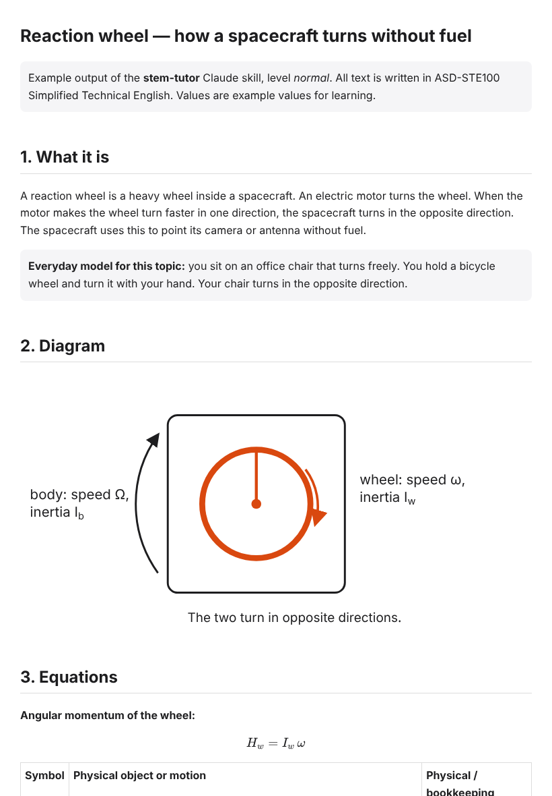

# STEM Tutor — a Claude Skill that explains engineering, physics and medicine so you can *see* the equations

**A free [Claude Skill](https://docs.claude.com/en/docs/agents-and-tools/agent-skills/overview) for students.** Ask Claude about any technical topic — control theory, Kalman filters, quaternions, thermodynamics, circuits, Python, the heart cycle — and get:

- ✅ An explanation in **Simplified Technical English** (ASD-STE100): short, clear sentences. Great if English is your second language.
- ✅ A **physical meaning for every equation**: which real object is each symbol, which terms are only "bookkeeping", and what happens at the extreme values.
- ✅ **Diagrams and animations** with play/pause and a time slider.
- ✅ Optional **interactive 3D models** (reaction wheel, engine, gearbox, heart, lungs) with cutaways and live numbers.
- ✅ A **phone-friendly HTML study file** with KaTeX math and dark mode. Open it offline, on any device.
- ✅ **Worked examples** with real numbers and **self-check problems**.

**▶ [Live examples](https://pruthvirajshinde2468-source.github.io/claude-stem-tutor-skill/)**

- 🫀 [The human heart — 3D teardown](https://pruthvirajshinde2468-source.github.io/claude-stem-tutor-skill/heart.html) (medical mode, deep)
- 🛰️ [Spacecraft attitude — Euler angles, DCM and quaternions](https://pruthvirajshinde2468-source.github.io/claude-stem-tutor-skill/spacecraft-attitude.html) (aerospace/GNC)
- 🔌 [Raspberry Pi 5 + stepper driver + motor — 3D circuit lab](https://pruthvirajshinde2468-source.github.io/claude-stem-tutor-skill/stepper-circuit.html) (photo → 3D mode)
- ⚙️ [Reaction wheel — how a spacecraft turns without fuel](https://pruthvirajshinde2468-source.github.io/claude-stem-tutor-skill/reaction-wheel.html)

[](https://pruthvirajshinde2468-source.github.io/claude-stem-tutor-skill/)

---

## New: photo → 3D circuit lab

Send Claude a photo of your electronics parts (for example a Raspberry Pi, a stepper driver, a motor and a power supply). The skill names each part, takes the wiring from the datasheets, and builds one interactive 3D page:

- **See-through layers:** whole bench, logic loop, motor loop, inside the Pi, inside the driver (H-bridges, sequencer), inside the motor (coils, N/S pole faces, rotor, gearbox).
- **Power switch and live current flow:** glowing particles show where current goes, in conventional or electron direction.
- **Commands you can send:** EN, DIR, STEP pulses. Live values, MOSFET states and a timing chart follow one model.
- **Fast and token-light:** the 3D engine ships with the skill. For each photo Claude writes only a ~40-line scene file.

Parts in the library now: Raspberry Pi 5, TMC2208 (BTT V3.0), NEMA 17 with planetary gearbox, DC supply, resistor. Any other part is shown as a labelled closed box.

## Why this skill

Many students can solve an equation but cannot say what it *means*. This skill forces every equation to connect to something you can point at, or test with your hands:

| Question the skill answers for every equation | Example (reaction wheel) |
|---|---|
| Which physical object is each symbol? | $I_w$ = the wheel's mass, and how far it sits from the axle |
| Is each term physical or bookkeeping? | the "= 0" is bookkeeping: look at the result, not for an object |
| What happens at the extreme values? | a very heavy spacecraft hardly turns |
| Can I test it with my hands? | spin on an office chair and turn your upper body |

It is also **fast and token-efficient**: it writes each diagram once, reuses one HTML template, and builds files from small fragments instead of rewriting them.

## Install

### Claude.ai (web, desktop and mobile app)
1. Download **`stem-tutor.zip`** from the [Releases](../../releases) page (or zip the `skills/stem-tutor` folder yourself).
2. In Claude, open **Settings → Capabilities → Skills** and upload the zip.
3. Start a chat and ask: *"Explain how a PID controller works."*

### Claude Code
```bash
git clone https://github.com/pruthvirajshinde2468-source/claude-stem-tutor-skill.git
cp -r claude-stem-tutor-skill/skills/stem-tutor ~/.claude/skills/
```

### ChatGPT, Gemini, Copilot, DeepSeek and other chat AIs
The whole skill is also one plain-text prompt: [`portable/STEM-TUTOR-PROMPT.md`](portable/STEM-TUTOR-PROMPT.md) (under 8,000 characters).
- **ChatGPT:** make a Custom GPT (Explore GPTs → Create → Configure) or a Project, and paste the file into **Instructions**. Free plan: paste it as the first message of a chat.
- **Gemini:** make a Gem and paste the file into **Instructions**.
- **Any other AI:** paste the file as the first message.

The AI gives you one HTML study file in a code block: save it as `lesson.html` and open it in a browser.
For a photo of electronics parts, the AI writes a short scene JSON. Paste it into the **[3D circuit lab](https://pruthvirajshinde2468-source.github.io/claude-stem-tutor-skill/circuit-lab.html)** and press **Build 3D**. The page link then holds the whole model, so you can share it.

### Coding agents (OpenAI Codex, Gemini CLI, Cursor, GitHub Copilot)
`skills/stem-tutor/SKILL.md` uses the open Agent Skills format. Copy the `skills/stem-tutor` folder into the agent's skills folder (for example `~/.codex/skills/` or `.agents/skills/`) or point the agent at `SKILL.md`.

## Use

Ask about any topic. Add a depth word if you want:

| Say | You get |
|---|---|
| **quick** | Short explanation, core equations, one worked example, one self-check |
| **normal** *(default)* | + diagram, 2D animation, common errors |
| **deep** | + every equation explained, interactive 3D model for physical objects |

Example prompts:
- *"Teach me the extended Kalman filter, normal level."*
- *"Deep: how does a control moment gyroscope work?"*
- *"Quick: what is a quaternion rotation?"*
- *"Explain the cardiac cycle for a medical student."* → medical mode: reference values, clinical conditions, red/blue blood flow.
- *"Walk me through this Python code."* → line-by-line walkthrough.

## Topics it works well for

Aerospace & GNC (attitude control, Kalman filters, orbital mechanics, reaction wheels) · Control theory (PID, state space, Bode, root locus) · Mechanics & dynamics · Electronics & digital logic · Signals & systems · Thermodynamics & fluids · Linear algebra & calculus · Programming (Python, C, MATLAB) · Anatomy & physiology · Pharmacology basics

## What is Simplified Technical English?

[ASD-STE100](https://www.asd-ste100.org/) is a controlled language from the aerospace industry. It is used to write aircraft maintenance manuals that people everywhere can read without errors: one word for one meaning, max 20–25 words per sentence, active voice. Those rules also make explanations easier to learn from.

## Credits

- The 3D mode is based on the ideas in [teardown](https://github.com/elvarofficial/teardown) (MIT).
- Math rendering: [KaTeX](https://katex.org/). 3D: [three.js](https://threejs.org/).

## Contributing

Ideas, new example lessons and fixes are welcome. Open an issue or a pull request. ⭐ Star the repo if it helps you study.

## License

[MIT](LICENSE)
